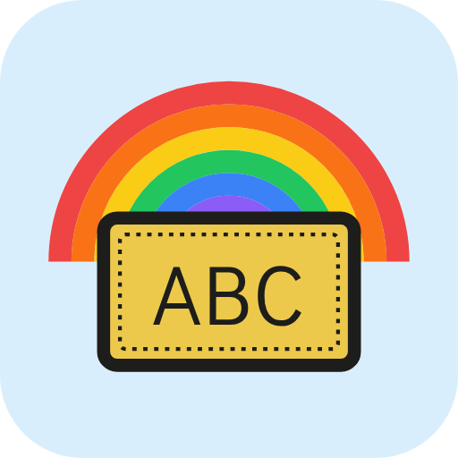

# Word Cards



A very simple spaced-repetition flashcard app for young readers (sight words),
packaged as an Android app with [Capacitor](https://capacitorjs.com).

- Hands-free: pick a color, then the child just reads each word out loud.
  The app listens **on the device** (no internet), rates the answer and moves
  to the next card by itself:
  - said it within ~2.5 s on the first try → **🤩 Easy**
  - within ~6 s, at most one wrong try → **🙂 Good**
  - got there eventually / several tries → **🤔 Hard**
  - not said within 15 s → the word is read aloud → **😟 Again**
- Cards are one-sided (no flipping). The rating buttons are always on screen,
  so a grown-up can tap one at any time to rate and move on.
- 🔊 on the card reads the word aloud (counts as help: best rating is Hard).
- The 🎤 button in the corner turns listening on/off. The home screen shows
  whether voice is ready.
- Progress is stored on the device.

### Practice rounds (not "done for the day")

The first round goes through every word in the set. After that each round is
built weakest-word-first: "Again" words come back 3 cards later, "Hard" words
once more later in the round, struggling words appear every round and
well-known words every 2–4 rounds. At the end of a round tap **Keep going**
for another one, or **All the words** for a full pass.

### Speech recognition: why Vosk

Options considered (all must run fully offline, English only):

| Engine | Notes |
| --- | --- |
| **Vosk** (Kaldi) — *chosen* | 40 MB English model, streaming results (needed to time the answer), official Android library, Apache-2.0. Can be **restricted to a word list (grammar)** so it only has to choose between the set's words and "unknown" — the biggest accuracy win for short single words from young children. |
| Whisper tiny.en / whisper.cpp | Most accurate on kids' speech when fine-tuned (e.g. on the MyST children's corpus), but processes whole clips rather than streaming, slower on phones, no ready Android library. Good candidate if Vosk turns out to struggle. |
| sherpa-onnx (zipformer / keyword spotting) | Modern and streaming, has keyword spotting, but integration means vendoring native libs and Kotlin sources. |
| Android `SpeechRecognizer` | Depends on Google's recognizer/offline packs being installed; not guaranteed on-device. |
| Picovoice, SoapBox Labs | Commercial; licence keys / cloud. SoapBox is the only child-specific engine but isn't available for this. |

No openly available on-device model is trained specifically on children's
speech, so the grammar restriction is what makes Vosk work well here.
The model is downloaded at build time by `scripts/fetch-speech-model.sh`.

## Adding / changing words and colors

Edit **`www/words.js`**. Each set has an `id`, `name`, `color`, `textColor`
and a list of `words`. Voice timing thresholds (`VOICE`) and the minimum round
size (`PRACTICE`) are at the bottom of the same file. Commit and push — GitHub Actions builds a new APK.

If the voice says a word oddly, use `{ text: "read", say: "reed" }` instead of
a plain string.

## Download

Latest APK: `https://github.com/ClaysonIO/simple-spaced-repetition/releases/latest/download/word-cards.apk`

Each build is published as a GitHub Release (`v1.0.<run number>`) with an
increasing version code, so it installs as an update over the previous one.

## Signing key

Android only accepts updates signed with the same key, so the build uses a
fixed key stored in repository secrets
(Settings → Secrets and variables → Actions):

| Secret | Value |
| --- | --- |
| `ANDROID_KEYSTORE_BASE64` | base64 of the `.jks` file |
| `ANDROID_KEYSTORE_PASSWORD` | keystore/key password |
| `ANDROID_KEY_ALIAS` | optional, defaults to `wordcards` |

Until the secrets exist, CI still builds a test APK (signed with a throwaway
key, downloadable from the workflow run's artifacts) but doesn't publish a
release. Create them once with `scripts/generate-keystore.sh` and keep a backup of the
keystore — losing it means uninstalling the app (and its progress) to update.

## Local development

```sh
npm install
npm run serve        # open http://localhost:8080 in a browser
npm run sync         # copy www/ into the Android project
./scripts/fetch-speech-model.sh   # needed before building the APK locally
```
